# Sistema de Gestión Empresarial – CompanyManagement

**Universidad Don Bosco – Facultad de Ingeniería**
Desarrollo de Software Empresarial – Desafío 3 (opción 2)

|   Integrante                |   Carné  |
|-----------------------------|----------|
| Diego José Rodríguez Majano | RM220481 |

---

## Descripción

API REST para la gestión de clientes y órdenes de una empresa mediana. El sistema permite registrar usuarios, iniciar sesión con JWT, administrar clientes y órdenes, y consultar tres reportes empresariales publicados en SQL Server Reporting Services. Las consultas principales se guardan en caché con Redis y la lógica está cubierta con pruebas unitarias.

Se incluye además un frontend en Next.js que consume la API.

## Tecnologías

| Área | Tecnología |
|------|------------|
| Backend | ASP.NET Core 8 Web API |
| Acceso a datos | Entity Framework Core 8, SQL Server |
| Seguridad | ASP.NET Core Identity, JWT Bearer |
| Caché | Redis (StackExchange.Redis) |
| Reportes | SQL Server Reporting Services 2022 |
| Pruebas | xUnit, EF Core InMemory |
| Frontend | Next.js 15, React, TypeScript |
| Documentación de la API | Swagger |

## Estructura del proyecto

```
Desafio3/
├── CompanyManagement.sln
├── docker-compose.yml
├── src/CompanyManagement.Api/
│   ├── Controllers/       Auth, Clientes, Ordenes, Reportes
│   ├── Data/              AppDbContext y carga inicial de roles y administrador
│   ├── DTOs/
│   ├── Migrations/        InitialCreate, ReportesProcedimientos, DatosSemilla
│   ├── Models/
│   ├── Repositories/      Patrón repositorio para clientes y órdenes
│   ├── Services/          Caché, generación de JWT y mapeo a DTOs
│   └── Settings/
├── tests/CompanyManagement.Tests/
├── frontend/
├── database/              Scripts SQL
├── reports/               Reportes .rdl
├── postman/               Colección de Postman
└── evidencias/
```

El acceso a datos se maneja con el patrón repositorio (`IClienteRepository`, `IOrdenRepository`). Los controladores validan la petición, consultan o invalidan la caché y devuelven DTOs. Todas las dependencias se registran en `Program.cs`.

## Modelo de datos

Base de datos: **CompanyManagement**

| Tabla | Campos |
|-------|--------|
| Clientes | Id, Nombre, Email (único), FechaRegistro |
| Ordenes | Id, ClienteId (FK), FechaOrden, MontoTotal |

Un cliente puede tener muchas órdenes y cada orden pertenece a un solo cliente. Al eliminar un cliente se eliminan sus órdenes en cascada. Las tablas de Identity (`AspNetUsers`, `AspNetRoles`, etc.) se crean en la misma base.

## Requisitos

- .NET SDK 8
- SQL Server 2019 o superior
- SQL Server Reporting Services 2022
- Redis (se incluye `docker-compose.yml`)
- Node.js 18.18 o superior (frontend)

## Instalación y configuración

### 1. Servicios

SQL Server y SSRS están instalados en un servidor Windows. Redis se ejecuta con Docker:

```bash
docker compose up -d
```

Esto levanta Redis en `localhost:6379` y RedisInsight en http://localhost:5540.

Para trabajar sin el servidor Windows se puede levantar también SQL Server en Docker:

```bash
docker compose --profile local up -d
```

### 2. Cadenas de conexión

Archivo `src/CompanyManagement.Api/appsettings.json`:

```json
"ConnectionStrings": {
  "DefaultConnection": "Server=10.144.231.92,1433;Database=CompanyManagement;User Id=sa;Password=Admin123;TrustServerCertificate=True;Connect Timeout=15;",
  "Redis": "localhost:6379"
}
```

| Sección | Descripción |
|---------|-------------|
| `Jwt` | Clave de firma, emisor, audiencia y duración del token |
| `Cache` | Prefijo de las llaves en Redis y tiempo de expiración (10 minutos) |
| `Reports` | URL del servidor de reportes y nombre de cada reporte |
| `AdminUser` | Usuario administrador creado al iniciar la aplicación |

### 3. Base de datos

Con migraciones de Entity Framework:

```bash
cd src/CompanyManagement.Api
dotnet ef database update
```

Las migraciones crean las tablas, los procedimientos almacenados de los reportes y datos de prueba (15 clientes y 28 órdenes). La API también aplica las migraciones pendientes al iniciar.

Como alternativa, en la carpeta `database/` están los scripts para ejecutar desde SSMS:

1. `01_crear_base_datos.sql`
2. `02_procedimientos_reportes.sql`
3. `03_datos_prueba.sql`

### 4. Ejecutar la API

```bash
dotnet run --project src/CompanyManagement.Api
```

Swagger: http://localhost:5151/swagger

### 5. Ejecutar el frontend

```bash
cd frontend
npm install
npm run dev
```

Frontend: http://localhost:3000

## Usuarios

| Rol | Email | Contraseña |
|-----|-------|------------|
| Admin | admin@companymanagement.com | Admin123! |
| User | Cualquier usuario creado con `/api/auth/register` | |

Los usuarios nuevos se asignan automáticamente al rol **User**. El usuario administrador y los roles se crean al iniciar la API.

## Endpoints

### Públicos

| Método | Ruta | Descripción |
|--------|------|-------------|
| POST | `/api/auth/register` | Registro de usuario |
| POST | `/api/auth/login` | Inicio de sesión, devuelve el token JWT |

### Autenticados

| Método | Ruta | Descripción | Caché |
|--------|------|-------------|-------|
| GET | `/api/clientes` | Listar clientes | Sí |
| GET | `/api/clientes/{id}` | Obtener cliente | Sí |
| POST | `/api/clientes` | Crear cliente | Invalida |
| PUT | `/api/clientes/{id}` | Actualizar cliente | Invalida |
| DELETE | `/api/clientes/{id}` | Eliminar cliente | Invalida |
| GET | `/api/ordenes` | Listar órdenes | Sí |
| GET | `/api/ordenes/{id}` | Obtener orden | |
| POST | `/api/ordenes` | Crear orden | Invalida |
| GET | `/api/ordenes/cliente/{clienteId}` | Órdenes de un cliente | |
| GET | `/api/auth/me` | Datos del usuario autenticado | |

### Solo Admin

| Método | Ruta | Reporte |
|--------|------|---------|
| GET | `/api/reportes/clientes-activos` | Clientes activos |
| GET | `/api/reportes/ingresos-clientes` | Ingresos por cliente |
| GET | `/api/reportes/clientes-inactivos` | Clientes inactivos |

Los endpoints de reportes devuelven la URL del reporte en SSRS (visualización, PDF y Excel). Con el parámetro `?redirigir=true` redirigen directamente al reporte.

### Códigos de respuesta

| Código | Caso |
|--------|------|
| 400 | Datos inválidos o cliente inexistente al crear una orden |
| 401 | Petición sin token o con token vencido |
| 403 | El rol del usuario no tiene permiso |
| 404 | Recurso no encontrado |
| 409 | Email duplicado |

## Ejemplos de uso

Inicio de sesión:

```bash
curl -X POST http://localhost:5151/api/auth/login \
  -H "Content-Type: application/json" \
  -d '{"email":"admin@companymanagement.com","password":"Admin123!"}'
```

```json
{
  "token": "eyJhbGciOiJIUzI1NiIsInR5cCI6IkpXVCJ9...",
  "expira": "2026-10-06T02:10:00Z",
  "email": "admin@companymanagement.com",
  "roles": ["Admin"]
}
```

Crear un cliente:

```bash
curl -X POST http://localhost:5151/api/clientes \
  -H "Authorization: Bearer <token>" \
  -H "Content-Type: application/json" \
  -d '{"nombre":"Comercial El Progreso","email":"ventas@elprogreso.com.sv"}'
```

Crear una orden:

```bash
curl -X POST http://localhost:5151/api/ordenes \
  -H "Authorization: Bearer <token>" \
  -H "Content-Type: application/json" \
  -d '{"clienteId":1,"montoTotal":350.75}'
```

En la carpeta `postman/` se encuentra la colección con todas las peticiones. Al hacer login, el token se guarda automáticamente en la variable `token` de la colección.

## Caché con Redis

Se utiliza `IDistributedCache` con Redis. Las respuestas se serializan en JSON y expiran a los 10 minutos.

| Llave | Endpoint |
|-------|----------|
| `CompanyManagement:clientes:todos` | GET /api/clientes |
| `CompanyManagement:clientes:{id}` | GET /api/clientes/{id} |
| `CompanyManagement:ordenes:todas` | GET /api/ordenes |

Invalidación:

| Operación | Llaves que se eliminan |
|-----------|------------------------|
| Crear cliente | listado de clientes |
| Actualizar o eliminar cliente | listado de clientes, el cliente y listado de órdenes |
| Crear orden | listado de órdenes, listado de clientes y el cliente de la orden |

Si Redis no está disponible, la API registra el error y responde directamente desde la base de datos.

Consulta desde `redis-cli`:

```bash
docker exec -it cm-redis redis-cli
KEYS CompanyManagement:*
HGETALL "CompanyManagement:clientes:todos"
TTL "CompanyManagement:clientes:todos"
```

## Reportes SSRS

| Reporte | Procedimiento | Columnas |
|---------|---------------|----------|
| `ClientesActivos.rdl` | `sp_ReporteClientesActivos` | Nombre, Email, TotalÓrdenes |
| `IngresosPorCliente.rdl` | `sp_ReporteIngresosPorCliente` | Nombre, Email, MontoTotal |
| `ClientesInactivos.rdl` | `sp_ReporteClientesInactivos` | Nombre, Email, FechaRegistro |

- **Clientes activos:** clientes con al menos una orden.
- **Ingresos por cliente:** total facturado por cada cliente.
- **Clientes inactivos:** clientes registrados en el último mes que no tienen órdenes.

Cada reporte tiene encabezado con título y fecha de generación, tabla con filas alternadas, fila de totales y numeración de páginas.

### Publicación

1. Configurar SSRS en Report Server Configuration Manager (base de datos del servidor de reportes, Web Service URL y Web Portal URL).
2. En el portal web, crear la carpeta `CompanyManagement` y cargar los tres archivos `.rdl`.
3. En cada reporte, en **Administrar → Orígenes de datos**, usar la cadena `Data Source=localhost\SQLEXPRESS;Initial Catalog=CompanyManagement` y credenciales de SQL Server.
4. Configurar la URL del servidor en `appsettings.json`:

```json
"Reports": {
  "ReportServerUrl": "http://10.144.231.92/ReportServer",
  "ReportsFolder": "/CompanyManagement"
}
```

## Pruebas unitarias

```bash
dotnet test
```

Se ejecuta desde la carpeta raíz de la solución. Las pruebas usan xUnit, una base de datos en memoria por prueba y una caché distribuida en memoria. Todas siguen el patrón Arrange-Act-Assert.

| Clase | Escenarios |
|-------|------------|
| `ClientesControllerTests` | Listar y guardar en caché, obtener por id, cliente inexistente (404), crear, email duplicado (409), actualizar, actualizar inexistente (404), eliminar con sus órdenes |
| `OrdenesControllerTests` | Crear orden, cliente inexistente (400), respuesta desde caché, invalidación de caché, órdenes por cliente, cliente inexistente (404), orden inexistente (404) |
| `AuthControllerTests` | Registro con rol User, contraseña incorrecta (401), login con rol en el JWT, acceso a reportes solo para Admin, endpoints públicos y protegidos |
| `ReportesControllerTests` | Generación de URL de SSRS y redirección |

## Frontend

Aplicación en Next.js ubicada en `frontend/`. Las peticiones a `/api` se redirigen a la API de .NET mediante `next.config.mjs`.

| Pantalla | Descripción |
|----------|-------------|
| Login y registro | Autenticación con la API |
| Resumen | Totales, clientes con mayor facturación, órdenes recientes y clientes nuevos sin órdenes |
| Clientes | Búsqueda, creación, edición y eliminación |
| Detalle de cliente | Historial de órdenes y registro de nuevas órdenes |
| Órdenes | Listado con filtro por cliente y registro de órdenes |
| Reportes | Acceso a los reportes de SSRS (solo Admin) |

## Evidencias

### Autenticación en Postman

| | |
|---|---|
| Registro de usuario | 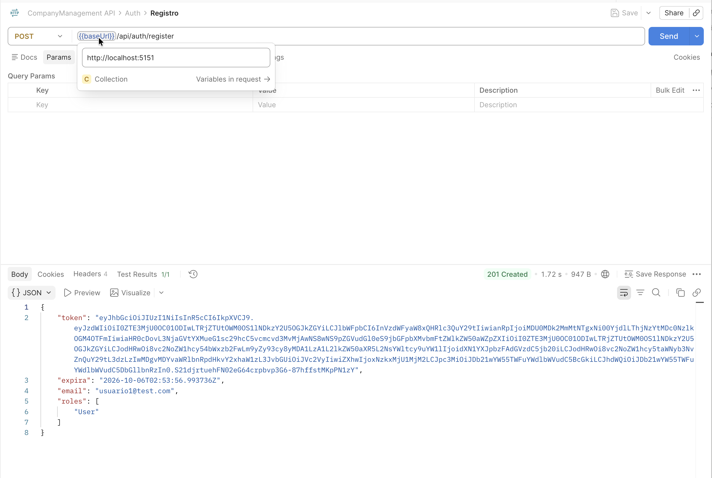 |
| Login como administrador | 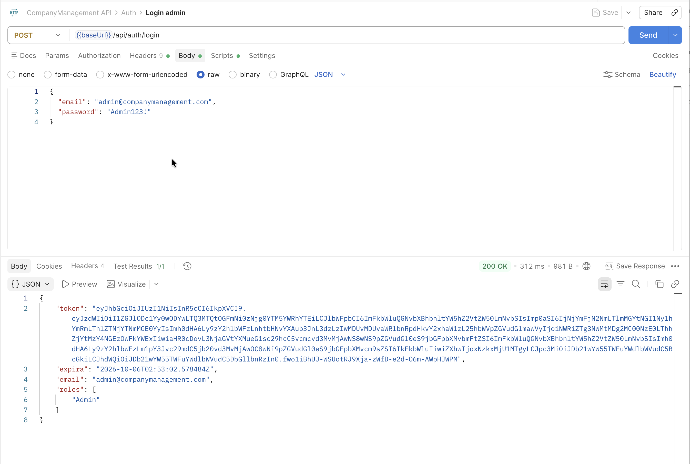 |
| Petición sin token (401) | 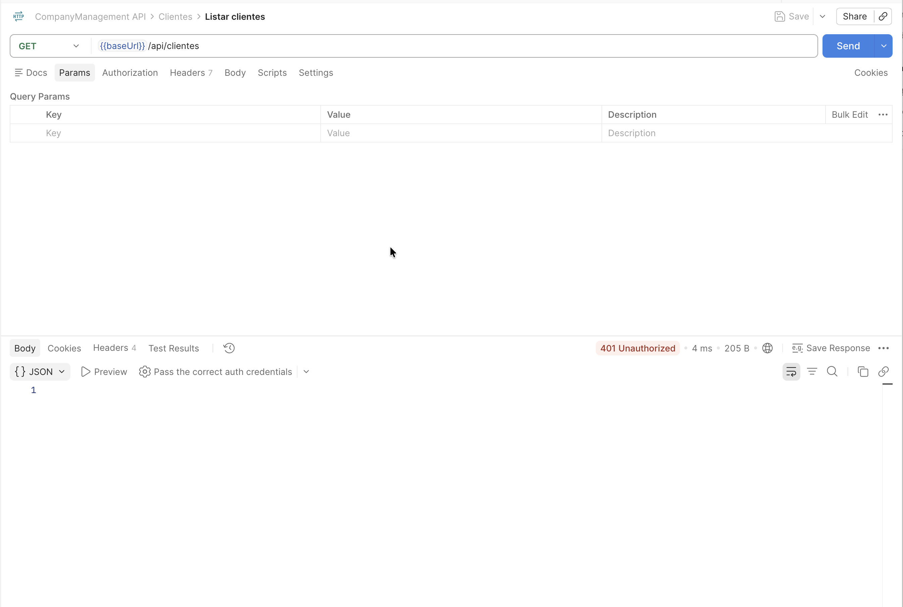 |
| Usuario sin rol Admin solicitando un reporte (403) | 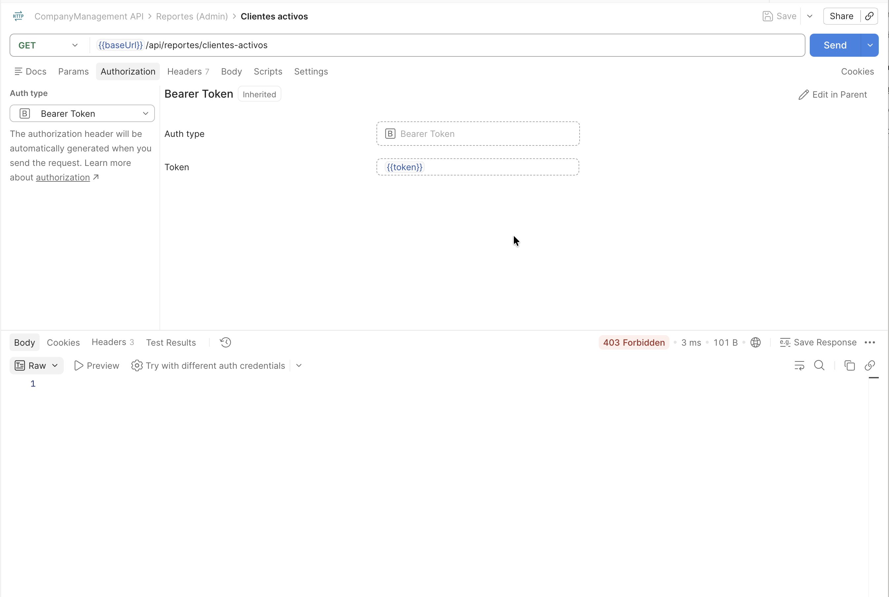 |
| Listado de clientes con token | 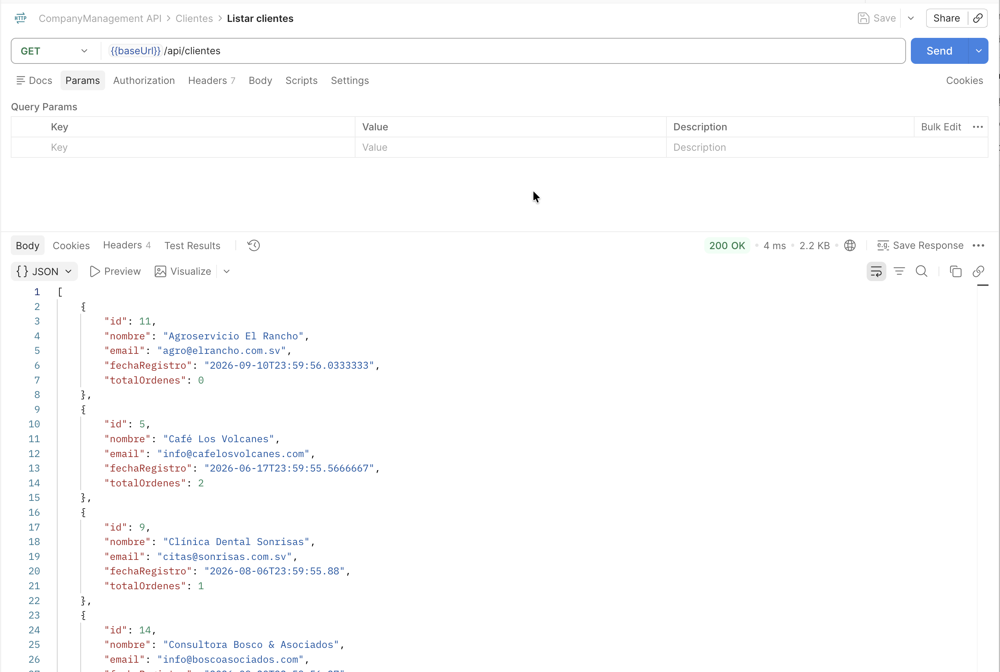 |
| Creación de orden | 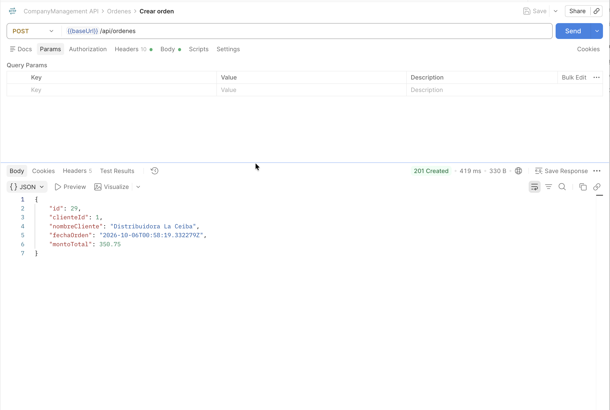 |

### Pruebas unitarias

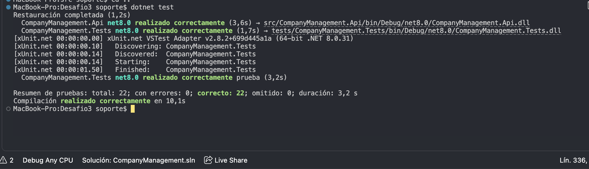

### Reportes

| | |
|---|---|
| Clientes activos | 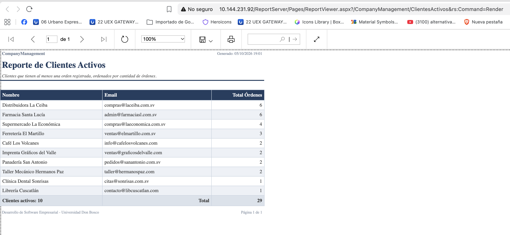 |
| Ingresos por cliente | 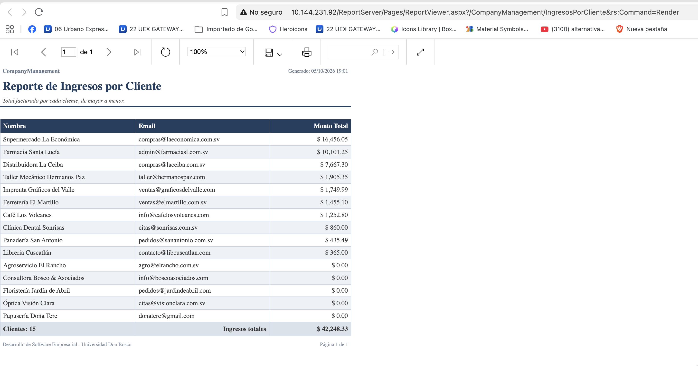 |
| Clientes inactivos | 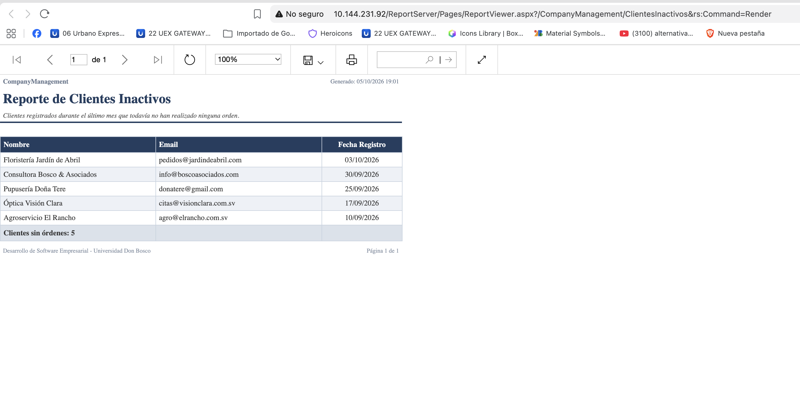 |
| Endpoint de reportes | 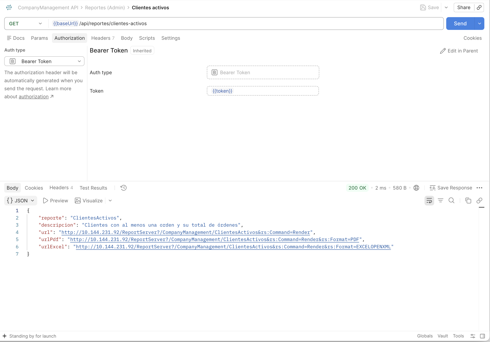 |

### Frontend

| | |
|---|---|
| Resumen | 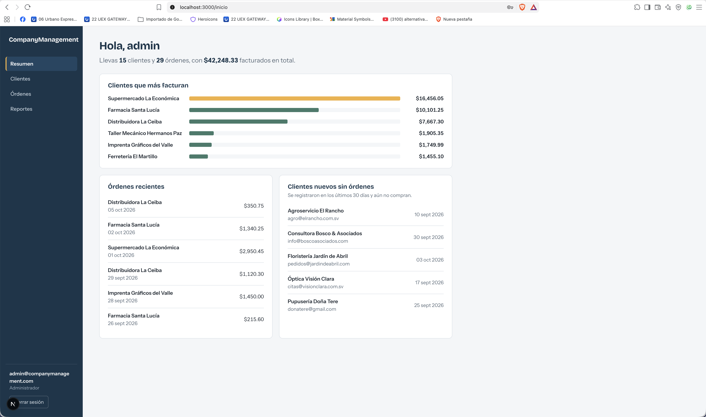 |
| Clientes | 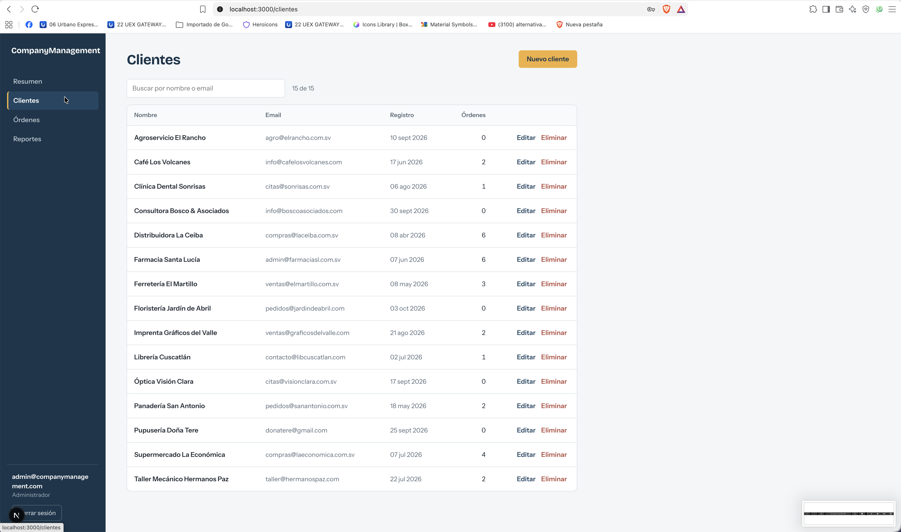 |
| Reportes | 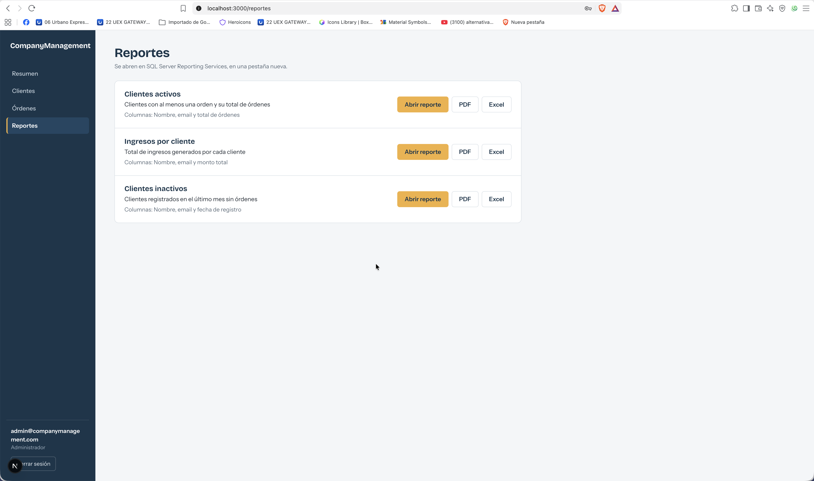 |

